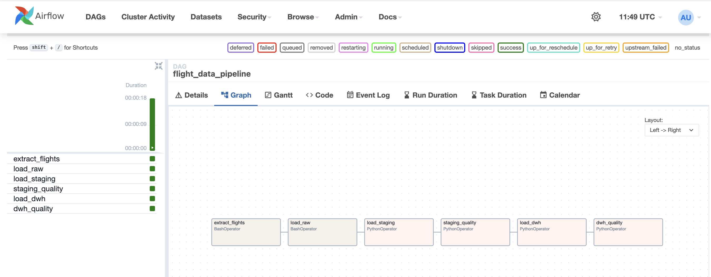
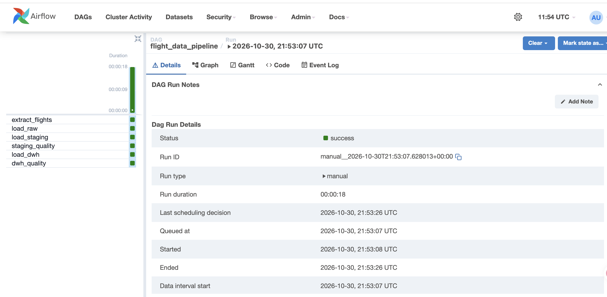
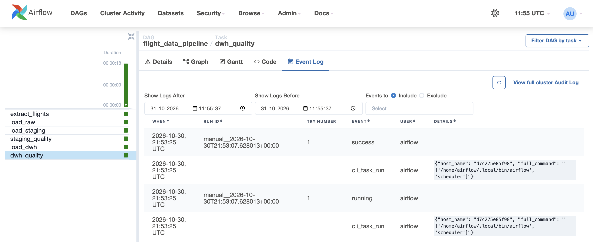
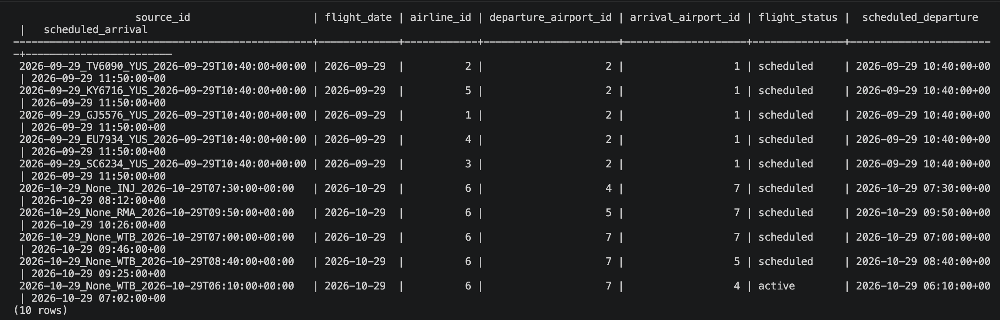
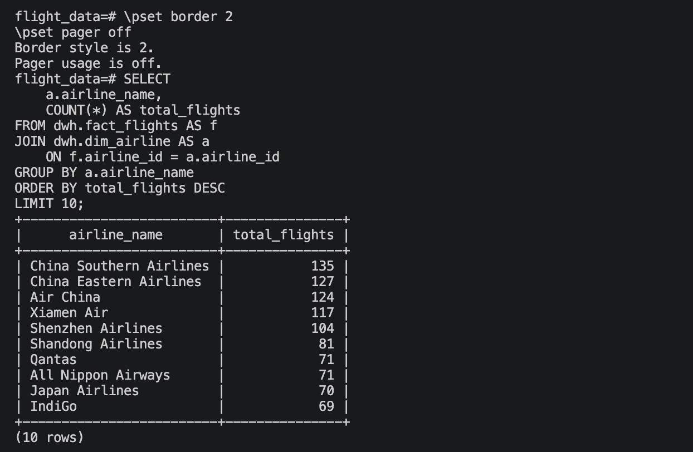

# Flight Data Platform

A data engineering project that collects flight data from the Aviationstack API, stores raw responses in PostgreSQL, transforms the data into staging tables, and loads it into a dimensional data warehouse.

Apache Airflow orchestrates the main ETL pipeline. A separate PySpark job processes the raw JSON data locally and writes the transformed output in Parquet format.

## Project Overview

The platform implements the following ETL workflow:

1. Extract flight data from the Aviationstack API.
2. Save the API response as JSON.
3. Load raw records into PostgreSQL.
4. Transform raw JSON data into structured staging tables.
5. Run data quality checks.
6. Load dimension and fact records into a dimensional data warehouse.
7. Run SQL queries to analyze the resulting dataset.

PySpark is used separately for local batch processing. It is not currently part of the Airflow DAG or the data warehouse loading process.

## Architecture

```text
                  Aviationstack API
                          |
                          v
                   Extract flight data
                          |
                          v
                       Raw JSON
                          |
                          v
                    PostgreSQL
                      Raw layer
                          |
                          v
                    Staging layer
                          |
                          v
                 Data quality checks
                          |
                          v
                Dimensional warehouse
                   /              \
                  v                v
           SQL analytics     Quality checks


       Separate processing workflow:

                 Raw JSON
                     |
                     v
                  PySpark
                     |
                     v
                Parquet files
```

## Technology Stack

| Technology | Purpose |
|---|---|
| Python | API ingestion and data processing |
| Apache Airflow 2.10.5 | Workflow orchestration |
| PostgreSQL 17 | Raw storage, staging, and data warehouse |
| SQL | Data transformations, quality checks, and analytics |
| PySpark 4.2.1 | Separate batch processing workflow |
| Docker Compose | Local environment and service management |
| Aviationstack API | Flight data source |

## Airflow Pipeline

The DAG is named `flight_data_pipeline` and contains six sequential tasks:

| Task | Description |
|---|---|
| `extract_flights` | Requests flight data from the Aviationstack API and saves the response as JSON |
| `load_raw` | Loads raw API records into PostgreSQL |
| `load_staging` | Transforms JSON fields into structured staging columns |
| `staging_quality` | Checks required values, duplicate identifiers, and data anomalies |
| `load_dwh` | Loads dimension and fact tables |
| `dwh_quality` | Validates warehouse records and dimension references |

The DAG is currently triggered manually. It uses Airflow's LocalExecutor in the local Docker Compose environment.

## Screenshots

The following screenshots show the Airflow workflow, a successful execution, data quality checks, and SQL queries against the data warehouse.

### 1. Airflow DAG Graph

The DAG structure and dependencies between the six pipeline tasks.



### 2. Successful DAG Execution

Airflow Grid View showing the successful execution of the pipeline tasks.



### 3. Data Warehouse Quality Checks

Task logs showing the results of the data warehouse quality checks.



### 4. Fact Table Sample

A sample of records stored in the `dwh.fact_flights` table.



### 5. SQL Analytics: Flight Counts by Airline

An SQL query using JOIN, GROUP BY, COUNT, and ORDER BY to identify the airlines with the highest number of flight records.



## Data Warehouse

The warehouse follows a dimensional modelling approach.

It contains:

- **Dimension tables** for airlines, airports, and dates.
- **Fact table** containing flight records and references to the dimensions.

The staging layer converts raw JSON fields into structured columns before loading the warehouse.

Data quality checks cover:

- Missing required values.
- Duplicate source identifiers.
- Missing flight identifiers.
- Invalid flight durations and timestamps.
- Fact table references to dimension records.

Some source records may contain incomplete or inconsistent values. Non-critical issues are reported as warnings; critical validation failures stop the corresponding pipeline task.

## PySpark Processing

The project also includes a standalone PySpark implementation in `spark/transform_flights.py`.

It:
- Reads the raw JSON file.
- Extracts flight attributes from the API response.
- Converts date and timestamp fields.
- Performs basic data quality checks, including record count and missing flight identifiers.
- Writes the transformed dataset in Parquet format.

### Alternative Processing Approach

The main ETL pipeline uses Python and SQL for data ingestion and transformation. This approach is sufficient for the current data volume and avoids unnecessary processing overhead.

The PySpark implementation demonstrates an alternative data processing approach. It is intentionally kept separate from the main Airflow workflow because distributed processing is not required at the current scale of this project.

This implementation demonstrates familiarity with Apache Spark and provides a basis for exploring how the processing layer could evolve as data volume and complexity grow.

## SQL Analytics

The SQL analytics script in `sql/08_analytics.sql` contains queries for exploring:

- Flight counts by airline.
- Flight counts by airport.
- Flights by date.
- Popular routes.
- Flight statuses.
- Scheduled departure times.
- Average flight duration.
- Flights scheduled more than two hours ahead.

## Sample Execution Results

In one successful sample run:

- 1,000 flight records were retrieved from the API.
- 1,000 records were loaded into the staging layer.
- 47 airline dimension records were inserted.
- 175 airport dimension records were inserted.
- 2 date dimension records were inserted.
- 1,000 fact records were inserted.

These figures describe one execution, not a fixed dataset size. Results may vary depending on the API response and subsequent runs.

The quality checks also identified incomplete or inconsistent source values. These findings are reported rather than silently treated as valid data.

## Project Structure

```text
flight-data-platform/
│
├── .github/
│   └── workflows/
│       └── tests.yml
│
├── dags/
│   └── flight_pipeline.py
│
├── ingestion/
│   ├── extract_flights.py
│   └── load_flights.py
│
├── spark/
│   └── transform_flights.py
│
├── sql/
│   ├── 01_create_staging.sql
│   ├── 02_load_staging.sql
│   ├── 03_data_quality.sql
│   ├── 04_create_dwh.sql
│   ├── 05_load_dwh.sql
│   ├── 06_dwh_quality.sql
│   ├── 07_add_date_fk.sql
│   └── 08_analytics.sql
│
├── tests/
│   ├── test_extract_flights.py
│   └── test_load_flights.py
│
├── screenshots/
│   ├── 01_airflow_graph.png
│   ├── 02_airflow_success.png
│   ├── 03_dwh_quality_logs.png
│   ├── 04_postgres_flight_facts.png
│   └── 05_sql_airline_analytics.png
│
├── data/
│   ├── raw/
│   └── processed/
│
├── Dockerfile
├── docker-compose.yml
├── requirements.txt
├── requirements-dev.txt
├── run_pipeline.py
├── .env.example
└── README.md
```

## Running Locally

### Prerequisites

- Docker Desktop and Docker Compose
- Python 3
- Java 17 for the standalone PySpark job
- An Aviationstack API key

### 1. Clone the repository

```bash
git clone https://github.com/Ekaterina1606/flight-data-platform.git
cd flight-data-platform
```

### 2. Configure environment variables

Create a local `.env` file from the example:

```bash
cp .env.example .env
```

Add your Aviationstack API key and configure the PostgreSQL and Airflow environment variables in `.env`.

Do not commit `.env` or publish API keys, passwords, or other credentials.

### 3. Build and start the services

```bash
docker compose build
docker compose up -d
```

### 4. Initialize the database schema

Before the first pipeline run, apply the SQL scripts that create the staging and warehouse schemas. Apply the date foreign key script if it is part of your chosen schema setup.

The database initialization scripts are in the `sql/` directory.

### 5. Run the pipeline

The main pipeline can be executed locally with:

```bash
python run_pipeline.py
```

Alternatively, open the Airflow web interface:

```text
http://localhost:8080
```

Find `flight_data_pipeline` and trigger the DAG manually.

### 6. Run the PySpark job

The standalone Spark transformation can be run with:

```bash
python spark/transform_flights.py
```

It reads the raw JSON input and writes Parquet output to `data/processed/flights`.

## Current Scope and Limitations

- The project runs in a local Docker Compose environment.
- Airflow uses LocalExecutor; no distributed Airflow deployment is configured.
- The DAG is manually triggered and does not currently use a scheduled interval.
- PySpark processing is implemented as a separate local workflow.
- The pipeline depends on the availability and response structure of the Aviationstack API.
- Automated tests cover API ingestion, JSON file handling, source ID generation, and database loading logic.
- API requests and database interactions are mocked in unit tests to avoid external dependencies.


## Testing

The project includes automated tests written with pytest.

The test suite covers:

- API pagination and error handling.
- Saving flight records to JSON.
- Generating unique source IDs.
- Handling incomplete flight records.
- Database insertion logic using mocked PostgreSQL connections.

Run the tests locally:

```bash
pip install -r requirements-dev.txt
python -m pytest -v

## Possible Next Steps

- Expand automated test coverage for data transformations and data quality checks.
- Add incremental loading and retry handling.
- Integrate the PySpark job into the orchestration workflow.
- Add monitoring and more detailed pipeline-level observability.
- Deploy the platform to a cloud environment.